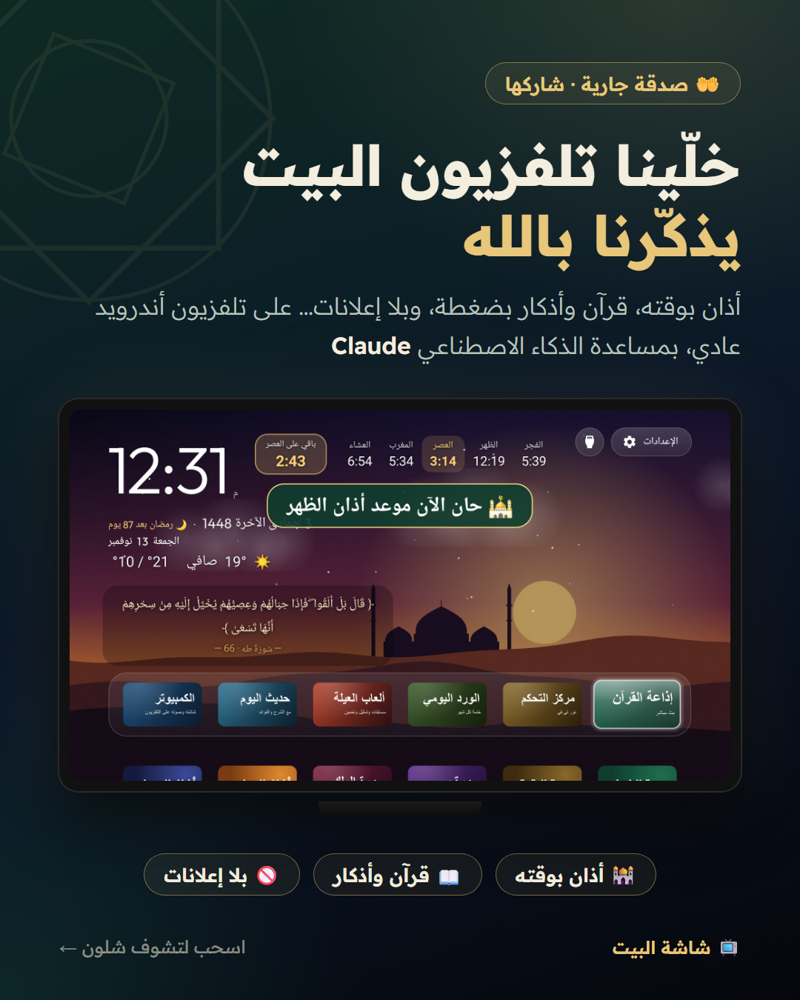
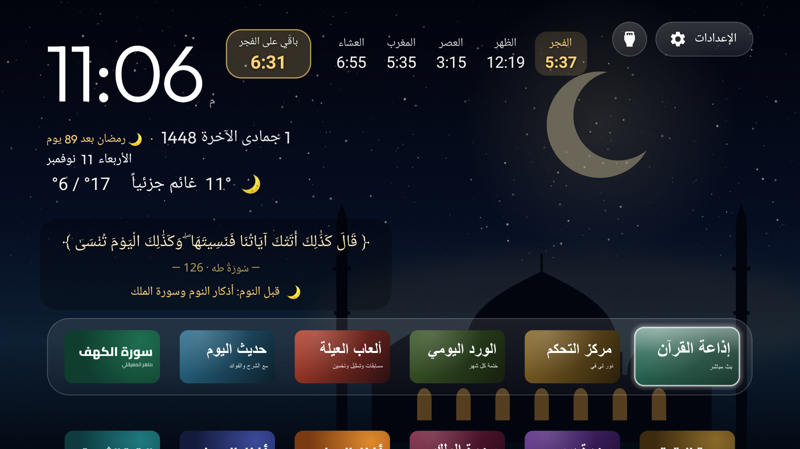
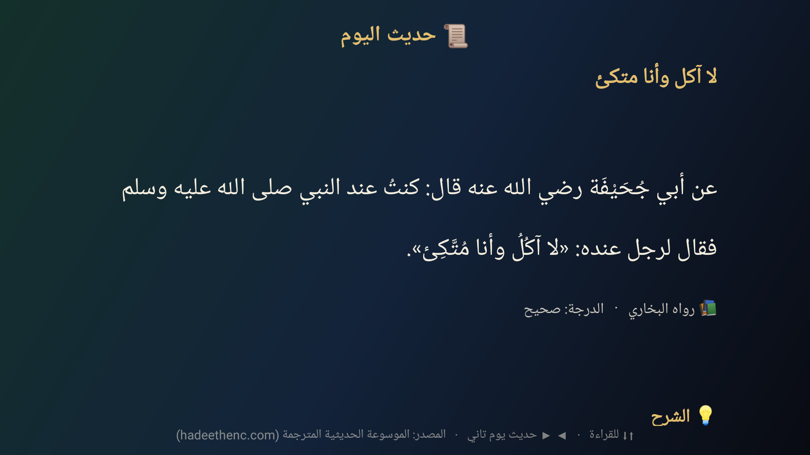
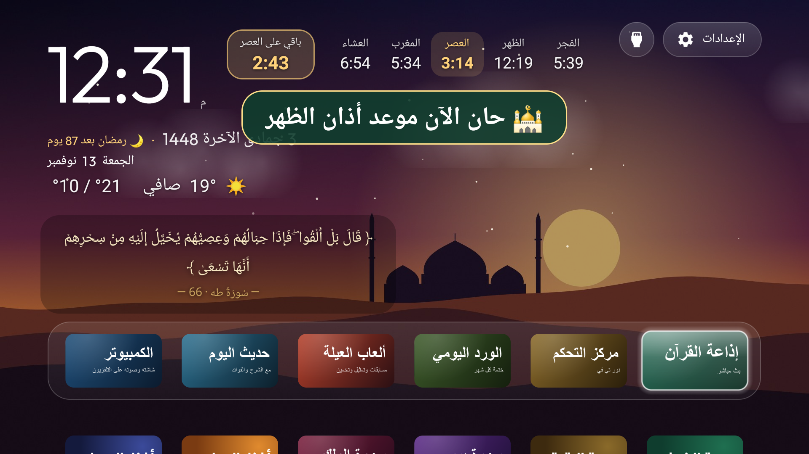

<div dir="rtl" align="center">

# 📺 شاشة البيت

### خلّي تلفزيون البيت يأذّن بوقته ويذكّرك بالله، وبلا إعلانات

على تلفزيون أندرويد عادي، بمساعدة الذكاء الاصطناعي Claude، وبلا ما تكون مبرمج.



**[⬇️ ركّبها ببيتك، 3 خطوات بس](#start)**

</div>

<div dir="rtl">

## شو فيها؟

<table>
<tr>
<td width="50%"><br><b>🕌 الأذان أولاً</b><br>بيطلع بوقت كل صلاة حتى لو التلفزيون مطفي. بيشغّل الشاشة، وبعد الأذان بيرجع يطفّيها لحاله. وقبل الأذان بعشر دقايق بيطلع تنبيه.</td>
<td width="50%"><br><b>🗓️ أوقات الصلاة قدّام عينك</b><br>عدّاد للصلاة الجاية، والتاريخ الهجري، والطقس، وآية بتتغيّر. والخلفية بتتلوّن مع الصبح والعصر والليل.</td>
</tr>
<tr>
<td><br><b>📜 حديث اليوم</b><br>كل يوم حديث صحيح مع شرحه، من الموسوعة الحديثية.</td>
<td><br><b>📖 كل شي بضغطة</b><br>الكهف والبقرة ويس والملك، والأذكار، والرقية، وإذاعة القرآن، والورد اليومي، وألعاب العيلة.</td>
</tr>
</table>

### وكمان
- 📱 **صفحة من الجوال** بلا تطبيق: بتكتب رسالة أو بترسم وبتطلع عالتلفزيون، وبتتحكم بالأذان والتذكيرات. ومحمية برمز بيطلع على الشاشة.
- 🧹 **بلا إعلانات:** بيعطّل تطبيقات الشركة اللي بتجمع البيانات وبتعرض إعلانات. **تعطيل مو حذف**، وبترجع بأمر واحد.
- 🧠 **ذاكرة نظيفة:** بيفضّي الذاكرة لحاله كل يوم، فالتلفزيون ما بيعلّق.
- 🌿 **يوم الجمعة:** بيذكّر بسورة الكهف والصلاة على النبي ﷺ.
- 🎲 **ألعاب للعيلة:** مسابقات وأسئلة وتمثيل، والجوالات هي الريموت.

## بيشتغل على شو؟

✅ أندرويد تي في وغوغل تي في (فيليبس، سوني، تي سي إل، شاومي، هايسنس أندرويد…)
❌ سامسونغ وإل جي لا، لأن أنظمتهم مو أندرويد.

<a name="start"></a>
## 🚀 الطريقة: 3 خطوات

**1.** لابتوب (ويندوز أو ماك) فيه [Claude Code](https://claude.com/claude-code)، والتلفزيون واللابتوب على نفس الواي فاي.

**2.** الصق هالسطر لـ Claude:

```
ركّب شاشة البيت من github.com/kinanfakat/bait-screen واقرا skills/bait-screen/SKILL.md وامشِ عليه خطوة خطوة
```

**3.** اعمل اللي بيقلّك، خطوة بخطوة. الشي الوحيد اللي بتعمله بإيدك هو إنك تضغط 7 مرات بإعدادات التلفزيون لتفعّل «خيارات المطوّر»، وClaude بيقلّك وين بالزبط.

## ⚠️ اقرا قبل ما تبلّش
- **تعطيل مو حذف.** ما في شي بينحذف من التلفزيون أبداً.
- قبل أي تغيير بتنحفظ نسخة احتياطية على جهازك، ومعها أمر بيرجّع كل شي متل ما كان.
- Claude بيستأذنك قبل كل خطوة بتلمس التلفزيون.
- الاستعمال على مسؤوليتك.

## 🤲 صدقة جارية
قال رسول الله ﷺ: «إذا مات الإنسان انقطع عنه عمله إلا من ثلاثة: إلا من صدقة جارية، أو علم ينتفع به، أو ولد صالح يدعو له» (رواه مسلم).
إذا نفعتك، شاركها، ولا تنسانا من دعائك.

## شكر
- الفكرة الأصلية والأساس من مشروع [نور تي في](https://github.com/majedphotos/noor-tv)، جزى الله صاحبه خيراً.
- الشاشة الرئيسية مبنية على [CleanYourTV](https://github.com/Gathin23/cleanyourtv) (رخصة MIT).
- مواقيت الصلاة من [Aladhan](https://aladhan.com)، والطقس من [Open-Meteo](https://open-meteo.com)، والأحاديث من [الموسوعة الحديثية](https://hadeethenc.com).

</div>
